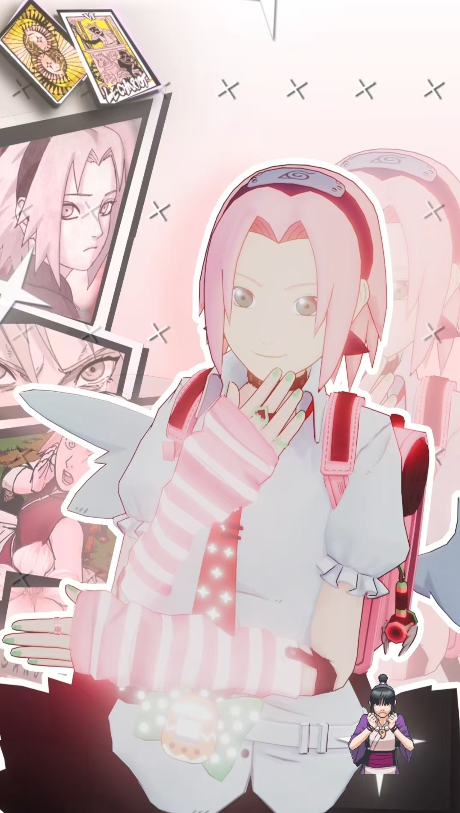

# Cartoon-Model-Shader

> **自用项目。**

做 MMD 模型三渲二的时候下载了很多插件 —— Autocel 智能卡通化着色器、Cycles Render Engine、glTF 2.0 format、MCP for Blender、MiaoboxNode、MikuMikuRig、MMD Tools、MMD Tools Append、MMD 自动换头、mmd_kafei_tools、Pose Library、卡渲秘咒。顺序繁多，每次从零开始做出来的效果都不一样，所以做了个脚本自动把模型渲染成我理想中的情况，现在再做可视化界面方便调参数。

## 效果示例



> 角色模型由本项目处理并渲染；图中背景使用 Adobe After Effects（AE）合成。

## 功能

本项目用于自动处理 MMD 模型的卡通渲染流程：

- 自动读取 PMX 模型并识别皮肤、头发、服装、眼睛等材质。
- 根据材质特征自动匹配卡通着色方案。
- 对无法确定的材质提供浏览器确认界面。
- 自动配置 Blender 渲染管线并输出渲染结果。
- 在浏览器中调整曝光、辉光、取景、Cel 色带与逐材质参数。
- 支持预览、参数预设、工程备份与安全保存。
- 预览或保存失败时尝试恢复到修改前的基线。
- 一键渲染工作流：选择模型 → 材质分析 → 材质确认 → 渲染设置 → 执行渲染 → 查看结果，
  并可在浏览器中监控任务、取消 / 重试、查看产物。

## 架构

```text
浏览器界面
    ↓ HTTP
本地控制服务
    ↓ Blender MCP
Blender 当前工程
```

浏览器负责参数调整和状态展示；本地服务负责材质识别、参数校验、任务管理、备份与保存；Blender 负责应用着色器、生成预览和正式渲染。

## 如何开始

要求：

- Windows 10/11
- Python 3.11 或 3.12
- Node.js 22
- Blender 与 Blender MCP

安装并启动：

```powershell
py -m venv .venv
.\.venv\Scripts\Activate.ps1
pip install -r requirements.txt

cd web
npm ci
npm run build
cd ..

uvicorn src.server.app:app --host 127.0.0.1 --port 8765
```

在 Blender 中打开工程并启动 MCP，然后访问：

- 工作台：<http://127.0.0.1:8765/>

### 一键渲染的环境变量

一键渲染复用仓库内固定入口 `render_pipeline/开始渲染.py`。下列变量（与固定脚本一致，
也兼容 `TOON_TUNER_` 前缀）**只由服务端读取**，前端接口从不接受任何路径或脚本：

- `TOON_MODEL_ROOT`：受信任的模型根目录（扫描 `.pmx` / `.pmd` / `.blend` / `.x`）。
- `TOON_SOURCE_BLEND`：提供节点组的源 `.blend`。
- `TOON_BLENDER`：Blender 可执行文件路径。
- `TOON_RUNTIME_DIR`：确认数据 / 预览 / 任务 / 锁的运行目录（默认 `runtime/`）。
- `TOON_MAPS_DIR`：侧车映射目录（默认用户数据目录，不进仓库）。
- `TOON_TUNER_OUTPUT_DIR`：渲染产物输出根目录（默认仓库根 `output/`）。

未设置 `TOON_TUNER_API_TOKEN` 时写接口沿用进程内会话令牌（由 `GET /` 注入页面）；
一键渲染的「执行渲染」子进程只会以白名单参数调用固定脚本，绝不接受前端提交的命令。

## 注意事项

- 当前项目仍在开发和真实 Blender 验收阶段。
- 首次使用请操作工程副本，不要直接使用唯一原件。
- 覆盖工程前请确认目标路径和备份文件。
- 工作台支持曝光、辉光、取景、Cel 色带与逐材质参数的调整与预览，可保存为完整预设，也可应用到当前工程。

详细说明：

- [技术设计](docs/技术设计.md)
- [安全检查](docs/安全检查.md)
